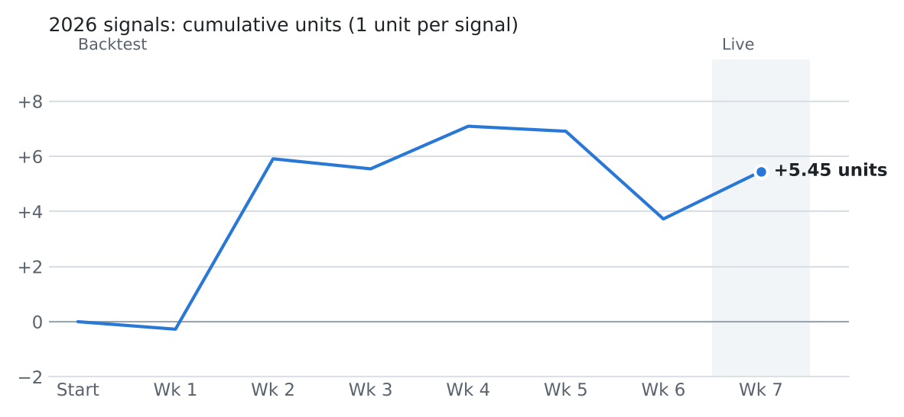
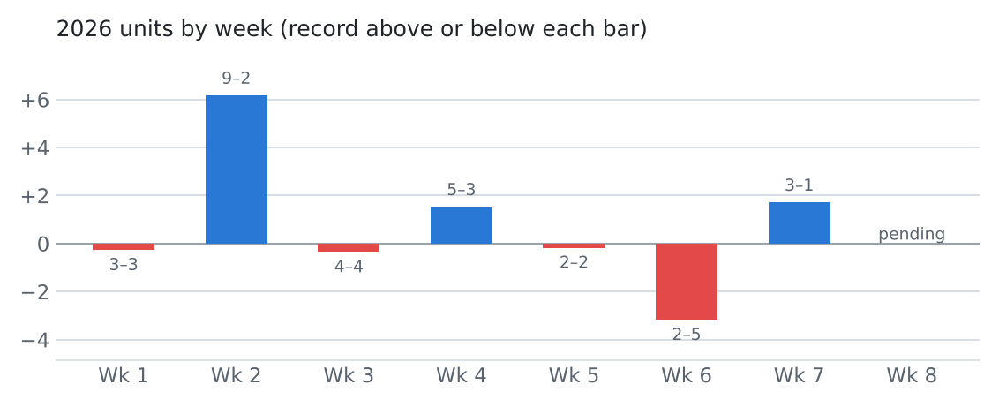
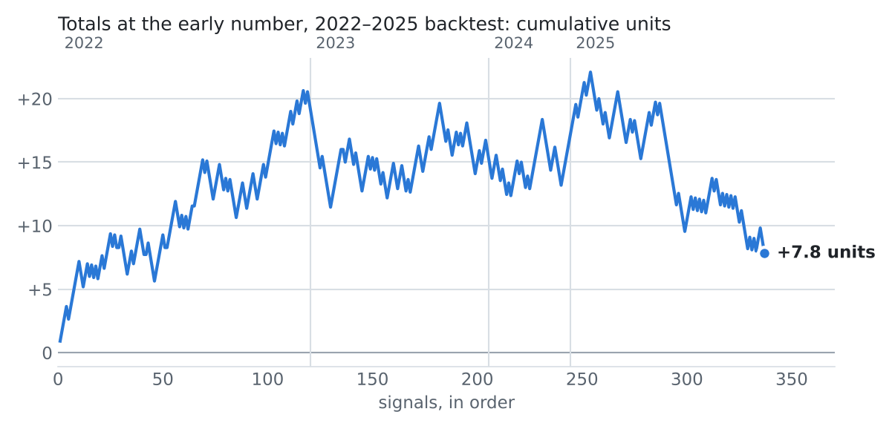

# 2026 CFB Model

Weekly ratings and signals from SP+ and BCF Toys FEI projections blended with the betting market. Each week folder holds that week's signals (README.md, bets.csv) and the model's ratings for every game (ratings.md, ratings.csv).

## Record

| | Signals | Record |
|---|---:|---|
| Live, posted before kickoff | 4 | no results yet |
| Backtest, out-of-sample | 44 | 25–19, +3.73 units |
| Real bets logged (`cfb log-bet`) | 0 | none logged yet |

<picture>
  <source media="(prefers-color-scheme: dark)" srcset="charts/cumulative-dark.png">
  
</picture>

<picture>
  <source media="(prefers-color-scheme: dark)" srcset="charts/weekly-dark.png">
  
</picture>

Live signals are frozen when posted and graded at the price shown. Backtest weeks apply the same rules with a model fit on seasons before 2026 only, so it never saw those games. Closing-number signals are graded at the median line across books.

## Weeks

| Week | Signals | Record | Status |
|---|---:|---|---|
| [Week 1](week-01/) | 6 | 3–3, -0.27 units | backtest |
| [Week 2](week-02/) | 11 | 9–2, +6.18 units | backtest |
| [Week 3](week-03/) | 8 | 4–4, -0.36 units | backtest |
| [Week 4](week-04/) | 8 | 5–3, +1.55 units | backtest |
| [Week 5](week-05/) | 4 | 2–2, -0.18 units | backtest |
| [Week 6](week-06/) | 7 | 2–5, -3.18 units | backtest |
| [Week 7](week-07/) | 4 | no results yet | live |

## Backtest, 2022–2025

<picture>
  <source media="(prefers-color-scheme: dark)" srcset="charts/backtest-dark.png">
  
</picture>

The headline rule over 2022–2025, each season scored by a model fit only on earlier seasons: 334 signals, 179–150–5 (54.4%), +12.7 units, ROI +3.8%. The closing total moved toward the signal by +0.70 points on average (+0.66 after the usual early-to-close drift).

## Rules

- **Totals, early number** (headline): bet the over or under at the O/U printed in SP+'s weekly sheet when the expected value at −110 is at least +2%.
- **Spreads, your book now**: bet a side at FanDuel, DraftKings or Fanatics when it clears +2% EV. The spread market already prices SP+ and FEI, so these are rare.
- Backtest weeks also include the closing-number rules.
- How it works, with diagrams: [docs/ARCHITECTURE.md](../docs/ARCHITECTURE.md). Backtests and caveats: the repository README and `reports/`.
