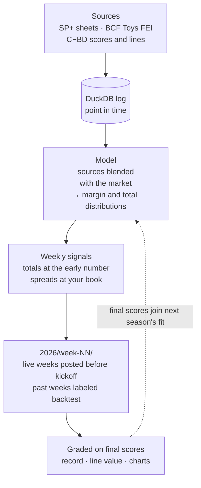

# CollegeFootballRatings2026

A weekly college football spread model: public rating systems (SP+, BCF Toys
FEI, Massey composite, CFBD Elo) blended with the market and turned into a full
distribution over final margins, so any line can be priced. The design is in
[`CFB_MODEL_PLAN.md`](CFB_MODEL_PLAN.md) and the owner's answers are in
[`DECISIONS.md`](DECISIONS.md).

## How it works



The weekly signals and season record are in [`2026/`](2026/README.md). How the data moves from source to signal, with
more detailed diagrams: [`docs/ARCHITECTURE.md`](docs/ARCHITECTURE.md).

## NIL compensation data

A separate layer stores the College Sports Commission's NIL Go and school revenue-share reports:
every release is versioned and archived in [`data/csc/releases/`](data/csc/releases/), checked for
internal consistency, and exported to [`data/csc/percentiles.csv`](data/csc/percentiles.csv). Design, caveats and the plan
for player-level estimates: [`docs/NIL_DATA_ARCHITECTURE.md`](docs/NIL_DATA_ARCHITECTURE.md). Latest
check and football summary: [`reports/csc_2026-10-30.md`](reports/csc_2026-10-30.md).

## Setup

```bash
uv sync
cp .env.example .env        # fill in CFBD_API_KEY (and GOOGLE_API_KEY for the live SP+ sheets)
uv run cfb init-db
uv run pytest
```

## Status

| Phase | State |
|---|---|
| 0 Scaffold | Done. DuckDB schema, sign-convention tests, `.env` handling, `cfb init-db`. |
| 1 CFBD backfill | **Run** (2014–2026 minus 2020, about 25 calls). No line disagreed with `formattedSpread`. |
| 2 Margin distribution | **Fit on 8,097 FBS games.** Normal (constant and linear sigma), a frequency-reweighted normal, and a key-number mixture. Selected by walk-forward **cover log loss** on every half-point line within 10 points of the center (what is bet); exact-margin log-likelihood is reported alongside. nfelo_mixture wins. |
| 3–4 Source adapters | **SP+ verified on real data** (see below); 2021–2026 ingested from the sheets' xlsx export. **BCF Toys 2022–2026 ingested**; every BCF final score agrees with CFBD. Massey is unit-tested on fixtures only. |
| 5 Blend + backtest | **Run on 2022–2025** (SP+ and BCF). Walk-forward, point-in-time, every combo, alpha fit, calibration, ATS/ROI, CLV, reality-check block. |
| 5b Totals backtest | `cfb backtest-totals`: SP+ and BCF projected totals vs the CFBD consensus close and the SP+ sheet's early O/U, same walk-forward design, total-points distribution picked by cover log loss. |
| 6 Weekly pipeline | Bet card works from the DB and line-shops the owner's books (FanDuel, DraftKings, Fanatics), keeping the best EV per side. Manual line entry works. The OddsPapi probe is not written: its API docs were not reachable. |
| 7 Tracking | `cfb log-bet`, `cfb settle` (close line, CLV in points and probability, result), summary. |

### SP+ acceptance test (plan §2.2)

`reports/sp_plus_validation.md`. The parser was run on the owner's 2024–2026
workbooks and each week was graded on Bill's ATS pick, against the sheet's
early-week spread and the sheet's own postgame scores:

- **2026 weeks 0–6: 6 of 6 match Bill's record exactly.**
- **2025: 14 of 16 rows match exactly.** Week 0-1 is short 4 games because the
  2025 Week 0 tab has no spreads. Postseason has the same wins (26), but Bill
  counts 3 more losses than the 44 games in the bowl tab.
- 2024 cannot be checked from the workbook: its postgame tab now holds 2025
  games. Run `cfb validate-sp-db` after the CFBD backfill to grade it with CFBD scores.

### Not yet verified, or approximations

- **Sides & Harvill:** `distribution/sides_harvill.py` is an *approximation* of the
  paper's idea (normal × fitted weights by |margin|), because arxiv.org was
  unreachable. It is labeled `sides_harvill_approx`. Swap in the exact method once
  the paper can be read.
- **nfelo mixture:** the structure follows the plan's description (normal + key-number
  components weighted by a super-gaussian, an opposite-sign lift, a 50/50 median
  rebalance); all parameters are refit by maximum likelihood. The rebalance is exact at
  market-line centers (integers, half points) and interpolated between them, so a
  blended model margin prices continuously (7.01 no longer prices like 7.5).
- **The Massey CSV** has not been seen; its parser logs anything it doesn't recognize.
- **SP+ 2023** abbreviates the projected winner and the spread team ("GSU", "App. St. -5").
  Those rows are resolved from the full-name ATS pick and the spread diff; about 70 rows
  where that is ambiguous are dropped, never guessed.

### Findings that differ from the plan

- The `SP+ performance` tab reports ATS **vs the early-week spread only**, plus
  absolute and median error. It has no closing-spread record. Weeks 0 and 1 are
  combined as "0-1".
- SP+ `Spread` cells always name the favorite ("Georgia -7.5"), so the sign is
  unambiguous for 2024–2026. The 2021–2023 tabs are unseen; a bare number is
  logged and skipped, never guessed.
- 2025 Week 0 is a short list ("Kansas 35.4, Fresno State 21.2") with no home/away
  and no lines; home/away comes from the CFBD join.
- Excel turned some "W-L" records and "12-10" scores into dates; the parser undoes that.
- Bill's January bowl dates sometimes carry the previous year.

## Commands

```bash
cfb backfill-cfbd                         # Phase 1: teams, games, lines, pregame Elo (cached)
cfb validate-sp --season 2025 --xlsx 2025_SP.xlsx   # SP+ check from a workbook, or omit --xlsx for live sheets
cfb ingest-sp --season 2025 [--xlsx path | --live-week N]
cfb ingest-bcf --season 2025
cfb fit-distribution                      # Phase 2 report
cfb backtest [--distribution best]        # Phase 5 report
cfb backtest-totals                       # same walk-forward backtest for over/unders
cfb record --season 2026                  # season record: walk-forward signals + real logged bets
cfb picks --season 2026 --week 8           # this week's totals picks at the early O/U (the record's rule)
cfb publish --season 2026 --week 8         # 2026/week-08/: ratings + actionable bets (frozen once written)
cfb fit                                   # production weights, alpha, distribution
cfb line set GAME_ID --book fanduel --spread -6.5 --price-home -110 --price-away -110
cfb week --season 2026 --week 8           # shops FanDuel, DraftKings, Fanatics (config/settings.yaml)
cfb log-bet GAME_ID --side home --line -6.5 --price -110 --stake 1 --book fanduel
cfb settle
cfb status                                # row counts, CFBD calls this month
cfb ingest-csc --fresh                    # CSC NIL Go + revenue-share percentiles (see below)
```

## Weekly routine

Ratings and bets are posted by week in [`2026/`](2026/README.md): each `week-NN/` folder has the week's
actionable bets (`README.md`, `bets.csv`) and the model's ratings for every FBS game (`ratings.md`,
`ratings.csv`). A week's bets are frozen once written; re-running only adds results. Weeks 1-6 are
backtest weeks: the same rules with a model fit only on earlier seasons.

```bash
uv run cfb backfill-cfbd --season 2026 --fresh   # scores and current lines (3 CFBD calls)
uv run cfb ingest-sp --season 2026 --download    # SP+ sheet with the new week's tab (no Google key needed)
uv run cfb ingest-bcf --season 2026 --fresh      # BCF Toys projections
uv run cfb publish --season 2026 --week 8        # write 2026/week-08/ and update 2026/README.md
git add 2026 && git commit -m "2026 week 8 picks" && git push   # the commit time shows it was posted before kickoff
# after the games
uv run cfb backfill-cfbd --season 2026 --fresh && uv run cfb publish --season 2026 --week 8   # adds results
```

## Conventions

`home_margin` = home − away. `exp_margin` = expected home margin. Book spreads are
stored per row in `lines.home_spread`, and modeling uses `mkt_margin = -home_spread`.
Margin distributions put zero mass on 0. CFBD `team_id` is the key; other sources
map to it through `data/reference/team_aliases.csv`, and unmatched names fail loudly.
