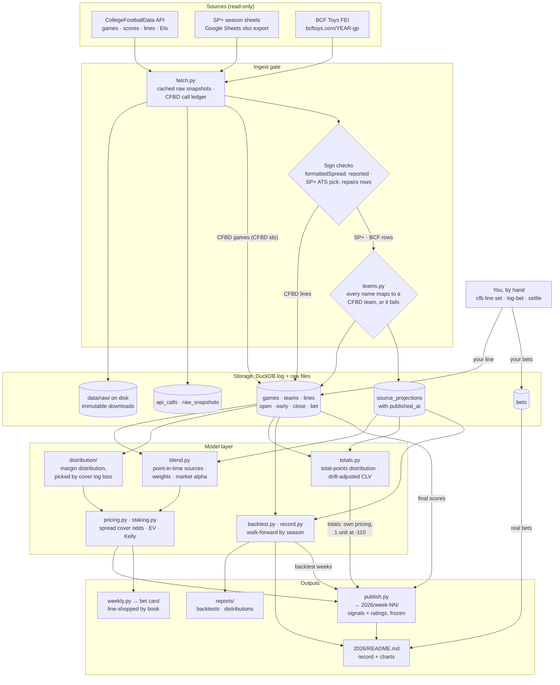
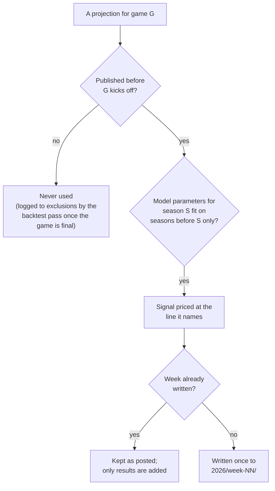
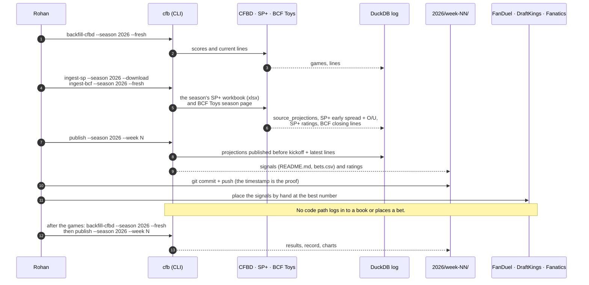

# Data architecture

Three layers:

- **Sources**, all read-only: CollegeFootballData (scores, lines, Elo), Bill Connelly's SP+ sheets, and BCF Toys FEI game projections.
- **One DuckDB log.** Every raw download is kept on disk, and every projection carries a published time (estimated, an hour before the week's first kickoff, for archived weeks), so a game only ever uses numbers dated before it kicked off.
- **Outputs**, built from that log: the weekly signal folders in `2026/` (written once, then only graded), the bet card, and the reports.

Nothing flows back out. No code path logs in to a sportsbook or places a bet; bets are placed by hand.

## End to end

Arrows into storage write rows. Arrows out of it are reads. Not drawn: every backtest run logs each game it drops to the `exclusions` table, with the reason.

## The point-in-time rules

## A week, end to end

## Tables

| Table | Written by | Read by | One row is |
|---|---|---|---|
| `games` | `backfill-cfbd` | everything game-scoped | one game, with its final score once played |
| `teams` | `backfill-cfbd` | `teams.py` | one CFBD team and its alternate names |
| `lines` | `backfill-cfbd`, `ingest-sp`, `ingest-bcf`, `line set` | `market.py`, `totals.py`, `weekly.py` | one provider's spread and total at one snapshot (open, early, close, bet) |
| `source_projections` | `ingest-sp`, `ingest-bcf` | `blend.py` | one source's projected margin and total for one game, with `published_at` |
| `source_ratings` | `backfill-cfbd`, `ingest-sp` | nothing yet; only `status` counts it | one team's rating from one source in one week |
| `raw_snapshots` | `fetch.py` | `fetch.py` cache | one downloaded file and where it is on disk |
| `team_aliases` | nothing yet (`sync_aliases_table` is never called) | nothing; `teams.py` reads `data/reference/team_aliases.csv` directly | a source's spelling of a team mapped to its CFBD id |
| `bets` | `log-bet`, `settle` | `record`, `publish` | one real bet: line, price, stake, close, CLV, result |
| `exclusions` | `backtest.py`, `totals.py` (via `backtest`, `backtest-totals`, `fit`, `record`, `picks`, `publish`) | `status` | one game dropped by one run, with the reason; re-logged every run |
| `api_calls` | `fetch.py` | `status` | one CFBD request, against the 1,000-a-month free tier |

Every timestamp is UTC. A week folder in `2026/` is written once; re-running `publish` only adds final scores and results.
