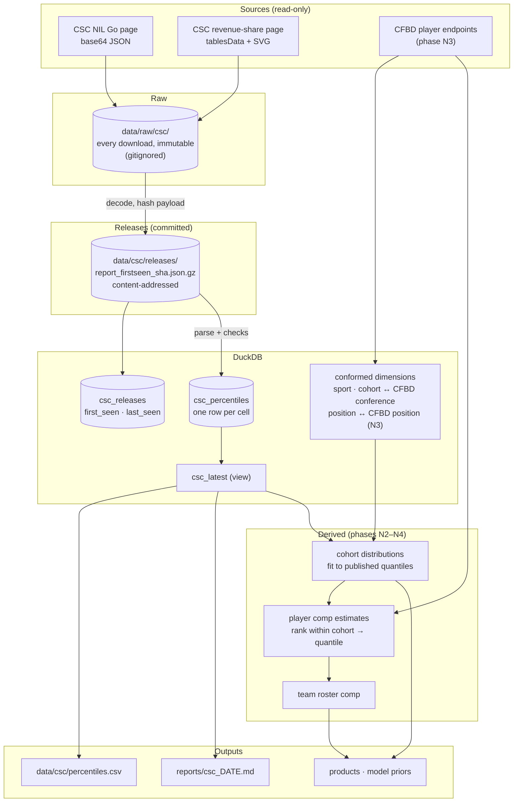

# NIL data architecture

A point-in-time store of public college-athlete compensation data, built so models can use it and so
it joins to the spread model's teams and conferences. Phase N1 (the College Sports Commission
reports) is built; the rest of this document is the plan for the phases after it.

```bash
cfb ingest-csc --fresh          # fetch both CSC pages, store any new release, check, export
cfb ingest-csc --from-archive   # rebuild the tables from data/csc/releases/ with no network
```

Outputs: the `csc_*` tables in DuckDB, `data/csc/percentiles.csv` (latest release, one row per
cohort), and `reports/csc_<date>.md` (releases, checks, football across both reports).

## Why this data is underused

- **It is not published as data.** Neither page has an HTML table, CSV or API. The NIL Go numbers are
  base64 JSON inside a base64 `<script src="data:...">`; the revenue-share numbers are a JSON table
  model plus pre-rendered SVG images in another. A reader sees one dropdown selection at a time.
- **Nobody keeps old versions.** The CSC says "the data may be updated as additional information is
  received". The Wayback Machine has no captures of either page (checked 2026-10-30). Every release
  this repo sees is archived in git, so this is the only revision history there is.
- **The two reports measure different things.** Different populations (everyone rostered, only paid
  athletes, only athletes with a cleared deal), different windows, different rounding. Comparing them
  naively gives wrong answers (see "Rules for using the numbers").
- **No school or player grain.** Every number is a cohort percentile. Using it for anything
  player- or team-level needs a modeling bridge (see "What the data can support").

## Sources

| Source | What it is | Grain | Status |
|---|---|---|---|
| CSC NIL Go report | Third-party NIL deals cleared through NIL Go | sport × (A4 / Non-A4, or conference for basketball) × football position; 90/75/50/25/10th percentiles and n | **Built** |
| CSC revenue-share report | School revenue-share payments reported through CAPS | sport × football position × cohort × {With $0, Without $0}; same percentiles | **Built** |
| CSC monthly NIL Data Reports | Deal counts and dollar totals cleared per month | month, maybe sport | Not built. Format not yet checked. |
| CFBD player endpoints | `/roster`, `/recruiting/players`, `/talent`, `/player/portal`, `/player/usage`, `/ppa/players/season`, `/player/returning`, `/stats/player/season`, `/draft/picks` | player-season, team-season | Not built. Needs `CFBD_API_KEY`. About one call per endpoint per season, so 5 seasons fit easily in the 1,000/month free tier (confirm counts on the first run). |
| School athletics finances | Knight-Newhouse database, Equity in Athletics (EADA) | school-year, by sport | Not built. The only public team-level spending figure. |
| Commercial NIL valuations | On3 and similar | player | **Not scraped.** Proprietary; use only under a license. |

### What the CSC pages contain (release of 2026-10-30)

| | NIL Go | Revenue share |
|---|---|---|
| Delivered as | `var B64="..."` → JSON `{percentileLabels, sports[{name, grouped, horizons[{label, start, end, thresholds, bands \| rows}]}]}` | `const sportsData` (index) → `const tablesData` (table model with group spans) and `const TABLE_SVGS` (the same tables as images) |
| Sports | 36 | 39 (16 men's, 23 women's) in 52 tables: football has one per position, basketball one each for With $0 and Without $0 |
| Cohorts | 100 (football: 12 positions × A4/Non-A4; basketball: 4 A4 conferences + Non-A4) | 146 (54 all-rostered, 92 paid) |
| Population | Rostered athletes with at least one cleared deal (`deal_holders`) | `all_rostered` ("With $0") and `paid` ("Without $0") |
| Football window | Deals submitted and cleared Jan 1 – Sep 30, 2026 | Payments in calendar 2026, agreements as of Sep 30, 2026 |
| Values | Unrounded dollars, full contracted amount, not annualized | Text rounded to $500 |
| Suppression | Published thresholds: n ≥ 100 for p90/p10, ≥ 40 for p75/p25, ≥ 10 for p50 | Same cells hidden; the checks confirm the same rule |
| Oddities | Six cohorts publish `count: "<10"` instead of a number (stored as `n_text`) | A `mixed` gender key exists and is empty |

## Layers



**Release identity.** A release is the sha256 of the decoded payload, not of the HTML, which also
carries form nonces and asset versions. Refetching an unchanged page only moves `last_seen_at`.
Rebuilding from the archive re-parses every release with the current parser, so a parser fix reaches
old releases.

**Point in time.** The release in effect at time *t* is the latest one with `first_seen_at` ≤ *t*.
`first_seen_at` is when this repo first saw it, not when the CSC posted it: the first release is
stamped 2026-10-30 even though the CSC posted it earlier. Revisions are caught only as often as the
page is fetched, so the fetch should run on a schedule (open question 2).

## Schema (built)

`csc_releases`: one row per distinct payload.

| column | meaning |
|---|---|
| `report` | `nil_go` or `revenue_share` |
| `payload_sha256` | release identity |
| `first_seen_at`, `last_seen_at` | first and latest fetch that returned this payload |
| `archive_path`, `n_cohorts` | the committed archive file; cohorts parsed |

`csc_percentiles`: one row per published cell. A cohort is
`(report, gender, sport, position, cohort, population, window_label)`.

| column | meaning |
|---|---|
| `gender`, `sport` | `men` / `women` / `mixed`; sport named as on the revenue-share page ("Track & Field (Outdoor)") |
| `position` | one of 12 football positions, otherwise `All Positions` |
| `cohort`, `a4` | `A4`, `Non-A4`, or a CFBD conference name (`ACC`, `Big Ten`, `Big 12`, `SEC`); `a4` is the roll-up flag |
| `population` | `all_rostered` (With $0), `paid` (Without $0), `deal_holders` (NIL Go) |
| `n`, `n_text` | cohort size; `n_text` keeps a published non-number such as `<10` |
| `percentile`, `value_usd` | 90/75/50/25/10 and dollars; NULL when suppressed |
| `min_n` | the published suppression threshold (NIL Go only) |
| `window_start`, `window_end`, `as_of`, `window_label` | the reporting window, parsed from the page; `window_label` is the original text |
| `source_ref` | file / row the cell came from |

`csc_latest`: `csc_percentiles` restricted to the newest release of each report.

## Data quality checks (built)

Run on every ingest; the report lists each result.

| Check | Catches |
|---|---|
| `monotone` | p90 ≥ p75 ≥ p50 ≥ p25 ≥ p10 |
| `suppression` | a cell hidden when n meets the threshold, or shown when it does not |
| `zero_mass` | With $0 and Without $0 describe one distribution. With zero share *z* = 1 − n_paid / n_all, the all-rostered percentile *p* must be $0 below *z* and, above it, lie between the paid percentiles around *q* = (*p* − *z*) / (1 − *z*). This also catches a row parsed into the wrong group. |
| `football_coverage` | any position × {A4, Non-A4} missing from either report |
| `nil_vs_roster` | more NIL deal holders than rostered players in a cohort |
| `svg_mismatch` | the downloadable SVG disagrees with the table data |
| parse issues | unknown sport, gender, cohort or window wording: logged and skipped, never guessed |

**First release:** every check passes except one expected warning. NIL Go counts 430 A4 "Position
Unspecified" deal holders, but CAPS rosters list only 162 under that label, so the two systems label
positions differently.

**Parsing trap, handled.** In the revenue-share tables "A4 Conferences" is a merged cell over one
or two rows (baseball's Non-A4 group has only a "Without $0" row). A parser that pairs rows by
order puts Non-A4 numbers under A4. `tablesData` gives each group's span. The SVG is parsed
independently by geometry and must agree, and a test pins the real baseball layout.

## Rules for using the numbers

1. **Do not mix populations.** A paid-only median is not a roster median. NIL percentiles cover only
   athletes with a cleared deal.
2. **Windows differ.** Football revenue share counts calendar-2026 payments, and the CSC treats
   performance incentives as payable until the season ends, which overstates them. NIL counts full
   contract value of deals cleared Jan 1 – Sep 30, 2026, whatever their length.
3. **NIL and revenue-share percentiles do not add.** There is no joint distribution. A combined
   figure needs an assumption about how the two correlate, stated wherever it is used.
4. **Precision differs:** revenue share is rounded to $500, NIL is not.
5. **Suppressed cells are not random.** They are the small cohorts.
6. **Query by release.** Use `csc_latest` for "now" and the release table for anything as of a date.

## What the data can support

The CSC gives each cohort's **distribution**. Public player data gives the **order of players
within a cohort**. Together they give player-level estimates. The bridge:

1. **Cohort distributions (N2).** Fit a continuous distribution to each cohort's published
   quantiles. For revenue share, combine With $0 and Without $0 into one zero-inflated distribution,
   which gives up to ten quantile constraints per football cohort. Candidates: zero-inflated
   lognormal, or a monotone spline on log dollars; pick by held-out quantile error. NIL's zero share
   comes from deal holders ÷ rostered (approximate, rule 1).
2. **Player ordering (N3–N4).** Within a cohort, rank players by what plausibly drives pay:
   recruiting and portal ratings, usage, PPA, starter status, draft outlook (CFBD).
3. **Rank → quantile → dollars.** A player's estimated rank in the cohort, read through the cohort
   distribution, gives an estimate with an interval. The CSC marginals keep every estimate
   anchored to real totals.
4. **Team roll-up.** Sum the estimates over a roster to get estimated roster spend by position.
   The only team-level check available is school athletics finance data.
5. **Link to the spread model, to test rather than assume.** Does roster spend add information to
   preseason ratings beyond talent composite and returning production? Run this in the existing
   walk-forward backtest. Limit: dollar data exists only from 2025–26 on, so expect one or two
   seasons of evidence for a while.

## Products this enables

In order of how much each depends on unbuilt layers:

1. **Offer benchmark.** "Where does $X sit for an A4 linebacker?", for athletes, families and
   agents. Needs only N2, and it is the clearest test that the distribution layer is right.
2. **Roster cap allocator.** For general managers: on-field value per dollar by position, against
   the cap of roughly $20.5M (2025–26), rising to a reported ~$21.3M. For example, A4 defensive
   linemen are the most often paid (83%) and have the highest paid median of any named position
   but quarterback ($150k).
3. **Transfer portal fit.** A player's estimated market value against a school's need and spend.
4. **Betting prior.** Roster spend as a preseason feature, tested in the existing backtest.
5. **Public explorer.** The first clean, versioned copy of these reports.

Sponsor–athlete matching for third-party NIL would need social-audience data, which no public source here has.

## First release, in numbers

From [`reports/csc_2026-10-30.md`](../reports/csc_2026-10-30.md):

- **75% of A4 football players** are paid revenue share in 2026 (7,743 rostered), against **29% of
  Non-A4** (18,755).
- **A4 quarterbacks:** paid median $230,000, paid 90th percentile $1,611,000. The other A4 position
  medians range from $93,000 (TE) to $150,000 (DL); specialists are paid about half the time.
- About **51% of A4** and **12% of Non-A4** rostered players have at least one cleared NIL Go deal
  (approximate; rule 1 and the position caveat).
- **The Non-A4 NIL median is $1,500–$1,570 at every position**, and most 10th–25th percentiles
  sit at $1,500. That looks like one flat group-licensing payment, not a market. EA Sports reportedly
  paid $1,500 per player for *College Football 26*; the 2026 terms are not confirmed, so this is a
  hypothesis. If it holds, the information in Non-A4 NIL is in the upper tail.

## Open questions

1. **CFBD key.** Not in this environment; it unlocks N3.
2. **Fetch cadence.** Weekly would catch revisions within a week; a scheduled run can open a commit
   only when a new release appears.
3. **First product.** Recommended: the offer benchmark, because it validates N2, which everything
   else depends on.
4. **Raw HTML in git?** Only the decoded payloads are committed (about 15 KB for both reports); the
   HTML (about 700 KB) stays local.

## Phases

| Phase | Scope | State |
|---|---|---|
| N1 | CSC ingest, release versioning, archive, checks, export, report | **Done** |
| N2 | `csc_distributions`: per-cohort fits, quantile function, percentile lookup, tests against the published quantiles | Next |
| N3 | CFBD player layer and position/team conformance | Needs key |
| N4 | Rank-to-quantile player estimates, team roll-up | After N2, N3 |
| N5 | First product prototype; roster-spend prior test in the backtest | After N4 |
| Ops | Scheduled refresh with a notice when a release changes | Any time |
